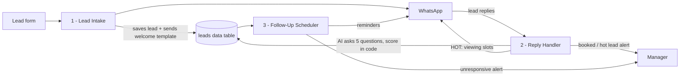

# WhatsApp Lead Qualification System (n8n)

An automation that turns Meta ad enquiries into **qualified, scored leads** on WhatsApp, with no agent involved until a lead is ready.

Built in **n8n** with the **WhatsApp Business Cloud API** and **Google Gemini**. The demo is set up for **real estate in Dubai**, and the same structure can be adapted to clinics, dental practices, HVAC, education and ecommerce.

---

## The problem

Businesses that run Meta ads often lose leads after the click:

- A buyer fills the ad form at 11 PM, and the agent replies the next afternoon.
- By then the buyer has already spoken to another agency.
- When many leads arrive together, nobody knows which ones are serious, so the best lead waits as long as the rest.

Every unanswered lead is ad budget wasted.

## What this system does

| Step | What happens |
|---|---|
| 1. Capture | The lead fills a form and consents to WhatsApp messages. |
| 2. Validate | Bad, fake and duplicate submissions are rejected. |
| 3. Contact | An instant WhatsApp message goes to the lead. |
| 4. Qualify | An AI agent collects 5 answers: rent or buy, budget, bedrooms, area, move-in timing. |
| 5. Score | Each lead is scored **HOT**, **WARM** or **COLD** by fixed rules in code. |
| 6. Book | HOT leads get viewing-slot buttons. The manager is alerted. |
| 7. Follow up | Quiet leads get automatic reminders. Unresponsive leads are flagged for the manager. |

The result: agents only call leads that are ready, and every lead is saved with its score and answers.

---

## Architecture

Three connected workflows share one data table called `leads`.



### Lead status lifecycle

```
new -> contacted -> qualifying -> hot / warm / cold -> booked
                         |
                         +-> unresponsive   (no progress, flagged to manager)
                         +-> stopped        (lead replied STOP)
                         +-> archived       (older row for a phone that re-submitted)
```

### Data table: `leads`

| Column | Purpose |
|---|---|
| `name`, `phone`, `interest` | From the form |
| `chat_id` | Cleaned WhatsApp number, used to match incoming replies |
| `status` | See lifecycle above |
| `attempts` | Follow-up counter |
| `next_contact_at` | When the scheduler may contact the lead next |
| `answers` | JSON with the 5 qualification answers |
| `history` | Last 10 messages, used as context for the AI |

---

## Workflow 1: Lead Intake

**Trigger:** n8n Form (`Lead Form`).

**Form fields:** Name, Phone (with country code), Looking for, WhatsApp consent (required checkbox).

**Flow:**

1. **Clean Phone** strips non-digits and `00` prefixes, and converts local formats (`03xxxxxxxxx` to `92...`, `05xxxxxxxx` to `971...`).
2. **Find Existing Lead** looks up the same number in the table.
3. **Check Lead** (code) rejects the submission if:
   - consent is not ticked
   - the phone is not a valid international number
   - name or interest is too short, or contains links or `<` `>`
   - the person previously replied STOP
   - the same number submitted within the duplicate window
4. **Is Submission OK** sends rejected submissions to a **Rejected Page** that explains why.
5. **Archive Old Leads** marks older rows for that number as `archived`, so there is one active lead per phone.
6. **Save Lead** creates the row (`status = new`).
7. **Send Welcome Template** sends the approved WhatsApp template `lead_welcome` through the Graph API.
8. **Mark Contacted** updates the row to `contacted`, sets `attempts = 1`, stores the welcome message in `history` and sets `next_contact_at` to 3 hours ahead.
9. **Show WhatsApp Link** shows the lead a confirmation page with a `wa.me` link to open the chat.

---

## Workflow 2: Reply Handler

**Trigger:** WhatsApp Trigger (incoming messages).

### Message routing

| Incoming message | Action |
|---|---|
| `STOP` | Marks the lead `stopped` and confirms no more messages will be sent. |
| Slot button tap (`slot_...`) | Marks the lead `booked`, confirms to the lead, notifies the manager. |
| Normal text | Goes to qualification (below). |
| Anything else (image, voice note, etc.) | Replies that only text is supported. |
| Number not in the table | Replies with a link to the enquiry form. |
| Lead is `stopped`, `booked` or `archived` | Sends a short holding reply. |
| Lead already scored | Replies that an agent already has their details. |

### Qualification

The **Qualify Lead** agent (Google Gemini) reads the lead's latest message, the answers collected so far and recent history. It extracts any of the five answers the lead clearly stated:

`rent_or_buy`, `budget_aed`, `bedrooms`, `area`, `move_in_timing`

The AI is deliberately limited. **Code does the critical work**, in the `Validate and Score` node:

- every answer is validated (for example, a budget must be a realistic number for rent or buy)
- an answer is only accepted if the lead's latest message actually supports it
- the next question is chosen by code, not by the AI, so the order is always the same
- the AI only writes a short acknowledgement (such as "Got it, renting!"); if it produces something unsafe or off-format, the code replaces it
- the system prompt tells the AI to ignore instructions inside lead messages, never quote prices or availability, never include links or phone numbers, and stay on topic

### Scoring (computed in code, not by the AI)

Once all five answers are filled:

| Score | Rule |
|---|---|
| **HOT** | Move-in within 30 days and a budget given |
| **WARM** | Move-in within 90 days |
| **COLD** | Everything else |

### After scoring

- **HOT:** the lead receives three viewing-slot buttons. The workflow waits 5 minutes, then alerts the manager with the lead's details (budget, bedrooms, area, move-in, and whether a viewing is booked). If no slot was chosen, the lead is sent to the follow-up scheduler immediately.
- **WARM / COLD:** the lead gets a closing message, and the result is stored in the table.

---

## Workflow 3: Follow-Up Scheduler

**Trigger:** schedule, **every hour**.

It runs two branches in parallel.

### Branch A: send reminders

Selects leads that:

- have status `qualifying`, `contacted`, `hot`, `warm` or `cold`
- have `attempts` between 1 and 4
- have a `chat_id`
- are due (`next_contact_at` has passed)
- were created in the last 24 hours

Then, for each lead:

| Lead type | Message | Next contact |
|---|---|---|
| Never replied (`contacted`) | Re-sends the approved `lead_welcome` template | +6 hours (attempts +2) |
| Replied, not finished | Free-text message chosen by attempt number (check-in, still interested, ask budget and move-in, last check-in with STOP option) | +2 hours (attempts +1) |

If a send fails, the attempt is not counted and the lead is retried in 1 hour.

### Branch B: escalate

A lead is marked `unresponsive` and the manager is notified on WhatsApp when:

- `attempts` is 5 or more and the next contact time has passed, **or**
- the lead is still `qualifying`, `contacted` or `hot` 24 hours after creation

### Timeline for a lead who never replies

| Time after the form | What happens |
|---|---|
| 0 h | Welcome template |
| about 3 to 4 h | Reminder 1 |
| about 9 to 10 h | Reminder 2 |
| about 15 to 16 h | Marked unresponsive and manager alerted |

Each step can run up to one hour late because the scheduler runs hourly.

---

## Requirements

- **n8n** (cloud or self-hosted) with data tables enabled
- **Meta WhatsApp Business Cloud API**: phone number ID, access token, and WhatsApp Trigger credentials
- An approved WhatsApp message template named `lead_welcome` (language `en`) with two variables:
  > Hi {{1}}, thanks for your interest in {{2}} in Dubai. I'm your property assistant. Are you looking to rent or buy?
- **Google Gemini API key** (the agent uses a Gemini Flash-Lite model)

## Setup

1. Create the `leads` data table with the columns listed above (all string columns).
2. Import the three workflows and connect credentials: WhatsApp API, WhatsApp Trigger, Google Gemini.
3. Get the `lead_welcome` template approved in Meta WhatsApp Manager.
4. Replace the hard-coded values:
   - the **manager's phone number** (3 notification nodes: booking, hot lead, unresponsive)
   - the **WhatsApp phone number ID** (several nodes)
   - the `wa.me` number on the **Show WhatsApp Link** page
   - the enquiry **form URL** in the Reply Handler's `Send Inactive Reply` node
5. Set `DUP_MINUTES` in the `Check Lead` node to `1440` for production (it is `2` for demos, so quick retakes are allowed).
6. Point the Meta webhook at the WhatsApp Trigger URL, then **publish all three workflows**.
7. Test with your own number: submit the form, answer the questions, then repeat once without replying to see the follow-ups.

---

## Customizing for other businesses

The structure stays the same (form, WhatsApp message, AI qualification, score, follow-up). What changes:

| What | Where |
|---|---|
| The questions and answer fields | AI system prompt and the `Validate and Score` code |
| Scoring rules | `Validate and Score` code |
| Viewing slots | `Send Viewing Slot Buttons` node (becomes appointments, consultations, quotes, etc.) |
| Reminder wording and timing | `Message 1 to 4` nodes and `Update Attempts` |
| Check frequency | `Every Hour` trigger |
| Alerts | The three manager notification nodes |

Ideas:

- **Clinics and dental:** qualify new patient enquiries, book appointments.
- **HVAC:** separate urgent repair calls from quote requests.
- **Ecommerce:** confirm orders on WhatsApp before dispatch.
- **Education:** qualify student enquiries, book counselling calls.

---

## Known limitations

- **Repeated reminders for non-repliers.** WhatsApp only allows approved templates to leads who have not replied, so those leads currently receive the same `lead_welcome` template each time. Adding a separate approved template for each reminder fixes this.
- **WARM and COLD leads are not followed up after 24 hours.** Their next-contact time is set 48 and 120 hours ahead, but the scheduler only handles leads created within the last 24 hours.
- **Storage is an n8n data table, not a CRM.** A CRM (HubSpot, Zoho, Google Sheets) can be added as an extra node.
- **Viewing slots are fixed** in the workflow and the manager confirms each booking manually.
- **Free-text replies need the 24-hour window.** WhatsApp only allows non-template messages within 24 hours of the lead's last message.
- **Question wording is English.** The AI acknowledgement can follow the lead's language, but the questions are fixed English strings in code.

## Tested

- Full run from form submission to a booked viewing in about 3 minutes, with the manager alerted on booking.
- A lead who never replied received reminders on schedule and was routed to the manager flow.
- Rejected submissions (missing consent, bad phone, duplicates) show a clear message on the form.

---

## Tech stack

n8n, WhatsApp Business Cloud API, Google Gemini, n8n data tables.
